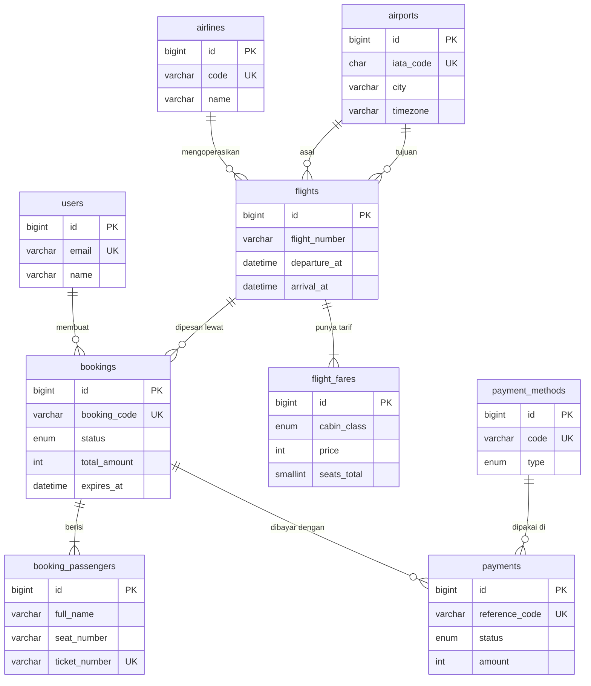

# Skema Database 1Tiket

Skema ini untuk website pemesanan **tiket pesawat satu arah** dengan pembayaran dummy. Terdiri dari **9 tabel** (belum termasuk tabel bawaan Laravel seperti `migrations` dan `personal_access_tokens`).

Kode DBML lengkapnya ada di `schema_1tiket.dbml` (tempel ke [dbdiagram.io](https://dbdiagram.io/d) untuk melihat diagramnya).

## 1. Diagram Relasi



Alur bacanya: **pengguna** membuat **pesanan** untuk satu **penerbangan**. Pesanan berisi satu atau lebih **penumpang**, dan dibayar lewat satu atau lebih **percobaan pembayaran**.

## 2. Ringkasan Tabel

| Kelompok | Tabel | Fungsi singkat |
|---|---|---|
| Akun | `users` | Akun penumpang |
| Data master | `airports` | Daftar bandara |
| | `airlines` | Daftar maskapai |
| | `flights` | Jadwal penerbangan |
| | `flight_fares` | Harga dan kapasitas per kelas |
| Pemesanan | `bookings` | Pesanan tiket |
| | `booking_passengers` | Penumpang, kursi, dan nomor tiket |
| Pembayaran | `payment_methods` | Daftar metode bayar dummy |
| | `payments` | Percobaan pembayaran |

## 3. Penjelasan Tiap Tabel

### 3.1 `users`

**Fungsi:** menyimpan akun penumpang yang bisa masuk dan memesan tiket. Tidak ada peran admin.

| Kolom | Penjelasan |
|---|---|
| `id` | Primary key |
| `name` | Nama pengguna |
| `email` | Unik, dipakai untuk login |
| `phone` | Nomor telepon (opsional), dipakai mengisi kontak pesanan otomatis |
| `password` | Hash bcrypt, tidak pernah disimpan polos |

**Relasi:** satu pengguna punya banyak `bookings`.

---

### 3.2 `airports`

**Fungsi:** daftar bandara untuk autocomplete pencarian, penentu rute, dan bahan animasi peta.

| Kolom | Penjelasan |
|---|---|
| `iata_code` | Kode 3 huruf unik (CGK, DPS, SUB). Ditampilkan besar di UI |
| `name` | Nama bandara lengkap |
| `city` | Kota. Ditampilkan kecil di bawah kode |
| `timezone` | Nama zona waktu IANA. Dipakai untuk menampilkan jam lokal (WIB/WITA/WIT) |
| `latitude`, `longitude` | Koordinat untuk menggambar titik dan garis rute di peta mini |

**Relasi:** satu bandara bisa menjadi asal atau tujuan di banyak `flights`.

**Kenapa ada `timezone`:** waktu disimpan UTC di `flights`. Tanpa zona waktu bandara, jam tiba di Makassar atau Jayapura akan salah tampil.

---

### 3.3 `airlines`

**Fungsi:** daftar maskapai. Nama sengaja fiktif (misalnya Nusa Air, Bayu Wings) agar aman untuk tugas.

| Kolom | Penjelasan |
|---|---|
| `code` | Kode singkat unik, dipakai sebagai awalan nomor penerbangan |
| `name` | Nama tampilan |
| `brand_color` | Warna hex untuk menandai maskapai di kartu hasil |

**Relasi:** satu maskapai punya banyak `flights`.

---

### 3.4 `flights`

**Fungsi:** satu baris mewakili **satu jadwal penerbangan pada satu tanggal dan jam tertentu**. Data diisi oleh seeder (sekitar 2.000 baris untuk 60 hari ke depan).

| Kolom | Penjelasan |
|---|---|
| `airline_id` | Maskapai pengoperasi |
| `flight_number` | Nomor penerbangan, contoh `NA201` |
| `origin_airport_id`, `destination_airport_id` | Bandara asal dan tujuan |
| `departure_at`, `arrival_at` | Waktu berangkat dan tiba dalam UTC. Durasi = selisih keduanya |

**Indeks penting:**
- `idx_flights_search` pada (asal, tujuan, waktu berangkat) mempercepat pencarian utama.
- `uq_flights_schedule` mencegah jadwal ganda untuk maskapai, nomor, dan waktu yang sama.

**Relasi:** milik satu `airlines`, dua `airports`, punya banyak `flight_fares` dan `bookings`.

**Yang sengaja tidak ada:** status penerbangan (delay/batal) dan tipe pesawat, supaya skema tetap ringkas.

---

### 3.5 `flight_fares`

**Fungsi:** menyimpan **harga dan kapasitas per kelas kabin** untuk satu penerbangan. Satu penerbangan biasanya punya dua baris: Ekonomi dan Bisnis.

| Kolom | Penjelasan |
|---|---|
| `flight_id` | Penerbangan terkait |
| `cabin_class` | `economy` atau `business` |
| `price` | Harga per penumpang dalam Rupiah |
| `seats_total` | Jumlah kursi kelas ini |

**Indeks:** (`flight_id`, `cabin_class`) unik, jadi tiap kelas hanya satu tarif per penerbangan.

**Sisa kursi tidak disimpan.** Dihitung saat dibutuhkan:

```
sisa kursi = seats_total
           - jumlah penumpang pada pesanan aktif (pending_payment atau paid)
             untuk penerbangan dan kelas tersebut
```

Dengan begitu tidak ada angka stok yang bisa menjadi tidak sinkron.

---

### 3.6 `bookings`

**Fungsi:** satu pesanan tiket. Satu pesanan berlaku untuk **satu penerbangan, satu kelas, dan 1–5 penumpang**.

| Kolom | Penjelasan |
|---|---|
| `booking_code` | Kode pendek unik yang dilihat pengguna (contoh `1T8K2QZ`) |
| `user_id` | Pemilik pesanan |
| `flight_id`, `cabin_class` | Penerbangan dan kelas yang dipesan |
| `passenger_count` | Jumlah penumpang |
| `unit_price` | **Snapshot** harga per penumpang saat memesan |
| `admin_fee` | Biaya layanan tetap (default Rp 5.000) |
| `total_amount` | `unit_price × passenger_count + admin_fee` |
| `contact_name`, `contact_email`, `contact_phone` | Kontak pemesan |
| `status` | `pending_payment`, `paid`, `expired`, `cancelled` |
| `expires_at` | Waktu dibuat + 15 menit |
| `paid_at` | Terisi saat pembayaran berhasil |

**Kenapa harga disalin ke `unit_price`:** jika harga di `flight_fares` berubah nanti, pesanan lama tetap menampilkan harga yang disepakati saat itu.

**Aturan status:**

```
pending_payment ──bayar sukses──▶ paid
      ├──lewat expires_at────────▶ expired
      └──pengguna membatalkan────▶ cancelled
```

Kedaluwarsa dihitung **malas (lazy)**: setiap kali pesanan atau peta kursi dibaca, sistem memeriksa `expires_at`. Jika sudah lewat dan status masih `pending_payment`, status diubah menjadi `expired` pada saat itu juga. Tidak perlu scheduler.

**Relasi:** milik satu `users` dan satu `flights`; punya banyak `booking_passengers` dan `payments`.

---

### 3.7 `booking_passengers`

**Fungsi:** daftar penumpang pada sebuah pesanan. **Satu penumpang = satu kursi = satu e-ticket.**

| Kolom | Penjelasan |
|---|---|
| `booking_id` | Pesanan induk |
| `title` | Gelar: Tn / Ny / Nn |
| `full_name` | Nama sesuai identitas |
| `id_number` | NIK atau nomor paspor (isi dummy) |
| `seat_number` | Kursi, contoh `12A`. Boleh kosong hingga pembayaran sukses |
| `ticket_number` | Nomor e-ticket, baru terisi ketika pesanan `paid` |

**Alur kursi dan tiket:**
1. Saat pesanan dibuat, `seat_number` terisi jika penumpang memilih kursi, dan kursi itu langsung dianggap terpakai (ditahan).
2. Saat pembayaran sukses, penumpang tanpa kursi dibagikan kursi bebas secara otomatis, lalu `ticket_number` dibuat untuk semua penumpang.
3. Jika pesanan `expired` atau `cancelled`, kursinya otomatis tidak dihitung lagi karena hanya pesanan aktif yang memengaruhi kursi terisi.

**Mencegah dua orang mengambil kursi yang sama:** pengecekan dilakukan di dalam transaksi database dengan `lockForUpdate` pada baris `flights` terkait, sehingga dua pemesanan bersamaan diproses berurutan.

**Mengapa e-ticket tidak punya tabel sendiri:** di sini satu penumpang selalu hanya punya satu tiket, jadi `ticket_number` cukup menjadi kolom di tabel ini. Lebih sederhana dan tetap cukup untuk boarding pass.

---

### 3.8 `payment_methods`

**Fungsi:** daftar metode pembayaran dummy yang ditampilkan di halaman bayar. Diisi oleh seeder.

| Kolom | Penjelasan |
|---|---|
| `code` | Kode unik: `qris`, `gopay`, `ovo`, `dana`, `shopeepay`, `bca_va`, `bni_va`, `bri_va`, `mandiri_va` |
| `name` | Nama tampilan |
| `type` | `qris`, `ewallet`, atau `bank_transfer`. Menentukan tampilan halaman bayar |
| `is_active` | Mematikan metode tanpa menghapus datanya |
| `sort_order` | Urutan tampil |

**Pengaruh `type` pada UI:**

| `type` | Tampilan di halaman bayar |
|---|---|
| `qris` | Gambar QR dummy + hitung mundur |
| `ewallet` | "Menunggu konfirmasi di aplikasi" + nomor referensi |
| `bank_transfer` | Nomor Virtual Account dummy + petunjuk transfer |

---

### 3.9 `payments`

**Fungsi:** satu **percobaan pembayaran** untuk sebuah pesanan. Karena pembayaran bisa gagal lalu dicoba ulang dengan metode lain, satu pesanan boleh punya banyak baris di sini.

| Kolom | Penjelasan |
|---|---|
| `booking_id` | Pesanan yang dibayar |
| `payment_method_id` | Metode yang dipilih |
| `reference_code` | Kode unik hasil generate: nomor VA, ID transaksi e-wallet, atau isi QR |
| `amount` | Nominal, sama dengan `bookings.total_amount` |
| `status` | `pending`, `success`, `failed`, `expired` |
| `expires_at` | Batas waktu bayar (mengikuti pesanan) |
| `paid_at` | Terisi saat berhasil |

**Alur dummy:**
1. Pengguna memilih metode → baris `payments` dibuat dengan `status = pending` dan `reference_code` acak.
2. Halaman bayar menampilkan QR / nomor VA / referensi sesuai `type`.
3. Pengguna menekan **"Simulasikan bayar berhasil"** atau **"Simulasikan gagal"**.
4. Backend memperbarui `payments.status`. Jika `success`: `bookings.status` menjadi `paid`, `paid_at` diisi, nomor tiket dan kursi dibuat.
5. Jika `failed`: pengguna bisa memilih metode lain selama pesanan belum kedaluwarsa. Baris baru dibuat, yang lama tetap tersimpan sebagai riwayat.

Hanya satu `payments` dengan status `pending` yang boleh aktif per pesanan. Saat metode baru dipilih, yang lama diubah menjadi `failed`.

## 4. Query Penting

### 4.1 Cari penerbangan

```sql
SELECT f.id, f.flight_number, f.departure_at, f.arrival_at,
       a.name AS airline, ff.price,
       ff.seats_total - COALESCE(taken.cnt, 0) AS seats_left
FROM flights f
JOIN airlines a      ON a.id = f.airline_id
JOIN flight_fares ff ON ff.flight_id = f.id AND ff.cabin_class = :cabin
LEFT JOIN (
    SELECT b.flight_id, COUNT(*) AS cnt
    FROM booking_passengers bp
    JOIN bookings b ON b.id = bp.booking_id
    WHERE b.cabin_class = :cabin
      AND (b.status = 'paid'
           OR (b.status = 'pending_payment' AND b.expires_at > UTC_TIMESTAMP()))
    GROUP BY b.flight_id
) taken ON taken.flight_id = f.id
WHERE f.origin_airport_id = :origin
  AND f.destination_airport_id = :destination
  AND f.departure_at >= :day_start_utc
  AND f.departure_at <  :day_end_utc
HAVING seats_left >= :passengers
ORDER BY ff.price ASC;
```

### 4.2 Kursi yang sudah terpakai pada satu penerbangan

```sql
SELECT bp.seat_number
FROM booking_passengers bp
JOIN bookings b ON b.id = bp.booking_id
WHERE b.flight_id = :flight_id
  AND b.cabin_class = :cabin
  AND bp.seat_number IS NOT NULL
  AND (b.status = 'paid'
       OR (b.status = 'pending_payment' AND b.expires_at > UTC_TIMESTAMP()));
```

### 4.3 Riwayat pesanan pengguna

```sql
SELECT b.booking_code, b.status, b.total_amount,
       f.flight_number, f.departure_at,
       o.iata_code AS origin, d.iata_code AS destination
FROM bookings b
JOIN flights  f ON f.id = b.flight_id
JOIN airports o ON o.id = f.origin_airport_id
JOIN airports d ON d.id = f.destination_airport_id
WHERE b.user_id = :user_id
ORDER BY b.created_at DESC;
```

## 5. Denah Kabin (tidak disimpan di database)

Tata letak kursi ditulis sebagai **konstanta di kode**, bukan tabel, supaya skema tetap kecil:

| Kelas | Baris | Kolom | Pola |
|---|---|---|---|
| Bisnis | 1–4 | A, C, D, F | 2-2 |
| Ekonomi | 5–24 | A, B, C, D, E, F | 3-3 |

Contoh nomor kursi: `3A` (bisnis), `12F` (ekonomi). `seats_total` di `flight_fares` sebaiknya sama dengan jumlah kursi pada denah (bisnis 16, ekonomi 120).

## 6. Urutan Migrasi (Laravel)

Urutan agar foreign key tidak error:

1. `users` (bawaan Laravel)
2. `airports`
3. `airlines`
4. `flights`
5. `flight_fares`
6. `bookings`
7. `booking_passengers`
8. `payment_methods`
9. `payments`

Urutan seeder: `AirportSeeder` → `AirlineSeeder` → `PaymentMethodSeeder` → `FlightSeeder` (sekaligus membuat `flight_fares`) → `DemoUserSeeder`.

## 7. Penyederhanaan yang Disengaja

| Yang tidak ada | Alasan | Jika ingin dikembangkan |
|---|---|---|
| Pesawat PP / multi-kota | Satu pesanan = satu penerbangan membuat skema dan UI sederhana | Tambah tabel `booking_flights` antara `bookings` dan `flights` |
| Tabel kursi | Kursi terisi cukup dihitung dari penumpang | Tabel `seats` per penerbangan jika ingin harga kursi berbeda |
| Tabel e-ticket | `ticket_number` cukup di `booking_passengers` | Tabel `tickets` jika perlu status check-in |
| Tabel admin / role | Data dikelola lewat seeder | Kolom `role` di `users` + CRUD penerbangan |
| Refund dan reschedule | Di luar lingkup tugas | Status baru + tabel `refunds` |
| Tipe penumpang (anak/bayi) | Semua dihitung dewasa, harga sama | Kolom `passenger_type` + aturan harga |
| Webhook pembayaran | Pembayaran disimulasikan lewat satu endpoint | Tabel `payment_events` untuk log notifikasi |
