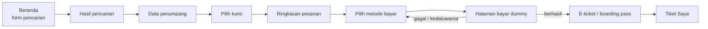

# PRD — 1Tiket (Pemesanan Tiket Pesawat)

| | |
|---|---|
| **Nama produk** | 1Tiket (ditulis "Satu Tiket" dalam kalimat) |
| **Jenis proyek** | Tugas / proyek pembelajaran. Tidak akan di-deploy ke produksi |
| **Versi** | 1.0 (disederhanakan dari PRD multi-moda) |
| **Tanggal** | 16 Okt 2026 |
| **Fokus utama** | UI yang menarik dan animasi bertema pesawat |

---

## 1. Ringkasan

1Tiket adalah website untuk mencari dan memesan **tiket pesawat satu arah** di dalam negeri Indonesia. Alurnya: cari penerbangan → pilih → isi data penumpang → pilih kursi → bayar → terima e-ticket (boarding pass digital).

Semua data bersifat **dummy**: jadwal dibuat dengan seeder, pembayaran disimulasikan, dan tidak ada integrasi dengan maskapai atau payment gateway sungguhan.

**Yang membuat proyek ini menonjol bukan kerumitan fiturnya, tetapi kualitas UI dan animasinya.** Fitur sengaja dibuat kecil supaya waktu bisa dipakai untuk menggarap tampilan dan gerak.

## 2. Tujuan

1. Alur pemesanan tiket pesawat berjalan **utuh dari awal sampai e-ticket** (end-to-end).
2. UI punya identitas visual sendiri dan tidak terlihat seperti template.
3. Animasi bertema pesawat menjelaskan sesuatu di setiap momen (bukan hiasan acak).
4. Kode dan skema database mudah dijelaskan saat presentasi tugas.

### Bukan tujuan (sengaja dibuang)

- Pesawat PP (round trip) dan multi-kota
- Transit/koneksi penerbangan
- Admin panel (data dikelola lewat seeder)
- Refund, reschedule, bagasi tambahan, makanan, asuransi
- Pembayaran sungguhan, email sungguhan, notifikasi push
- Aplikasi mobile native (cukup website responsif)
- Multi bahasa (hanya Bahasa Indonesia)

## 3. Pengguna

| Persona | Kebutuhan |
|---|---|
| **Penumpang** | Mencari jadwal, membandingkan harga, memesan, menyimpan e-ticket |
| **Dosen/penguji** (pengguna tersirat) | Bisa mencoba alur lengkap dalam beberapa menit tanpa setup rumit |

Tidak ada peran admin. Satu jenis akun: penumpang.

## 4. Alur Pengguna



Login wajib sebelum langkah **Data penumpang**. Pengguna yang belum login diarahkan ke halaman masuk, lalu dikembalikan ke langkah yang sama.

## 5. Fitur dan Prioritas

**P0 = wajib ada, P1 = sebaiknya ada, P2 = bonus jika waktu cukup.**

### 5.1 Akun

| ID | Fitur | Prioritas |
|---|---|---|
| A1 | Daftar dan masuk dengan email + password | P0 |
| A2 | Keluar (logout) | P0 |
| A3 | Ubah profil (nama, telepon) | P2 |

### 5.2 Pencarian

| ID | Fitur | Prioritas |
|---|---|---|
| S1 | Form: bandara asal, tujuan, tanggal berangkat, jumlah penumpang (1–5), kelas (Ekonomi/Bisnis) | P0 |
| S2 | Autocomplete bandara (kode IATA + kota) | P0 |
| S3 | Tombol tukar asal ↔ tujuan | P0 |
| S4 | Validasi: asal ≠ tujuan, tanggal tidak boleh di masa lalu | P0 |
| S5 | Strip tanggal ±3 hari dengan harga terendah per hari | P1 |

### 5.3 Hasil Pencarian

| ID | Fitur | Prioritas |
|---|---|---|
| R1 | Daftar penerbangan: maskapai, nomor penerbangan, jam berangkat/tiba, durasi, harga | P0 |
| R2 | Urutkan: harga termurah, berangkat paling awal, durasi tersingkat | P0 |
| R3 | Filter: maskapai dan rentang waktu berangkat (pagi/siang/sore/malam) | P1 |
| R4 | Tampilan kosong yang berguna jika tidak ada penerbangan (saran tanggal lain) | P1 |
| R5 | Penanda sisa kursi sedikit ("Sisa 3 kursi") | P1 |

### 5.4 Pemesanan

| ID | Fitur | Prioritas |
|---|---|---|
| B1 | Form data penumpang per kursi (gelar, nama lengkap, NIK/paspor) | P0 |
| B2 | Data kontak pemesan (nama, email, telepon) yang terisi otomatis dari akun | P0 |
| B3 | Pilih kursi lewat denah kabin. Jika dilewati, kursi dipilihkan otomatis | P1 |
| B4 | Ringkasan harga: harga tiket × penumpang + biaya layanan = total | P0 |
| B5 | Pesanan menahan kursi selama 15 menit (status `pending_payment`) | P0 |
| B6 | Batalkan pesanan yang belum dibayar | P1 |

### 5.5 Pembayaran (dummy)

Lihat bagian 6.

### 5.6 E-ticket dan Riwayat

| ID | Fitur | Prioritas |
|---|---|---|
| T1 | E-ticket bergaya boarding pass per penumpang: rute, jam, kursi, kode booking, QR | P0 |
| T2 | Halaman "Tiket Saya": daftar pesanan (Menunggu bayar, Terbayar, Kedaluwarsa, Dibatalkan) | P0 |
| T3 | Unduh/cetak e-ticket (print stylesheet atau PDF sederhana) | P2 |

## 6. Pembayaran Dummy

Tidak ada transaksi nyata. Halaman pembayaran meniru pengalaman bayar, lalu pengguna menekan tombol simulasi untuk menentukan hasilnya.

| Jenis | Pilihan | Tampilan di halaman bayar |
|---|---|---|
| **QRIS** | QRIS | Gambar QR dummy (di-generate dari kode referensi) + hitung mundur |
| **E-Wallet** | GoPay, OVO, DANA, ShopeePay | Layar "Menunggu konfirmasi di aplikasi" + nomor referensi + hitung mundur |
| **Transfer Bank (VA)** | BCA, BNI, BRI, Mandiri | Nomor Virtual Account dummy + petunjuk transfer singkat + hitung mundur |

**Aturan:**
- Batas waktu bayar 15 menit sejak pesanan dibuat. Setelah itu status menjadi `expired` dan kursi dilepas.
- Tombol di halaman bayar: **"Simulasikan bayar berhasil"** dan **"Simulasikan gagal"**. Hasilnya dikirim ke endpoint simulasi di backend.
- Saat berhasil: status pesanan `paid`, nomor tiket dibuat untuk tiap penumpang, kursi yang belum dipilih dibagikan otomatis.
- Saat gagal: pengguna boleh memilih metode lain selama pesanan belum kedaluwarsa.
- Biaya layanan: tetap Rp 5.000 per pesanan (nilai dummy).
- Semua logo dan nama bank/e-wallet hanya ilustrasi untuk tugas. Gunakan ikon teks atau badge sederhana, bukan logo resmi.

## 7. Halaman (Sitemap)

| Halaman | Rute | Isi utama |
|---|---|---|
| Beranda | `/` | Hero beranimasi, form pencarian, contoh rute populer |
| Hasil pencarian | `/cari?...` | Daftar penerbangan, filter, urutan |
| Data penumpang | `/pesan/penumpang` | Form penumpang + kontak |
| Pilih kursi | `/pesan/kursi` | Denah kabin |
| Ringkasan | `/pesan/ringkasan` | Rincian harga, tombol lanjut bayar |
| Pembayaran | `/bayar/{kode}` | Pilih metode, lalu halaman bayar dummy |
| E-ticket | `/tiket/{kode}` | Boarding pass per penumpang |
| Tiket Saya | `/tiket-saya` | Riwayat pesanan |
| Masuk / Daftar | `/masuk`, `/daftar` | Form autentikasi |

Langkah pemesanan memakai **stepper** di atas halaman (Penumpang → Kursi → Ringkasan → Bayar).

## 8. Arah Desain

> Nilai tambah proyek ada di sini. Hindari tampilan default: latar hitam polos dengan tombol putih, kartu seragam bersudut sama, atau gradient dekoratif.

**Konsep:** "Boarding pass di bawah langit." Elemen tiket (perforasi, stub, kode) bertemu elemen penerbangan (garis rute, awan, jendela pesawat).

**Usulan awal palet** (bisa direvisi saat desain):

| Nama | Hex | Peran |
|---|---|---|
| Tinta Malam | `#0E2A47` | Teks utama, elemen gelap |
| Langit Pagi | `#CFE5F5` | Latar hero dan bidang besar |
| Kertas Tiket | `#F6F8FA` | Latar kartu dan halaman |
| Sinyal Oranye | `#F26A21` | Aksen tunggal: tombol utama, pesawat, penanda penting |
| Landasan | `#5B6B7B` | Teks sekunder, garis |

**Tipografi:** satu atau dua keluarga font dengan karakter (bukan Inter/Roboto/Arial). Font monospace hanya untuk data berkode: kode IATA, nomor penerbangan, kode booking, nomor kursi.

**Logo:** wordmark **1Tiket**. Angka "1" dirancang menyerupai stub tiket. Versi terang, gelap, dan versi kecil untuk favicon.

**Copy:** bahasa Indonesia, santai tapi jelas, kata kerja pada tombol ("Cari penerbangan", "Pilih kursi", "Bayar sekarang"). Hindari kalimat deskripsi fitur.

**Kualitas dasar:** responsif sampai layar mobile, fokus keyboard terlihat, kontras AA, tidak ada teks terpotong (nama bandara ditampilkan sebagai kode besar + kota kecil).

## 9. Spesifikasi Animasi

Animasi adalah fokus proyek, jadi tiap animasi punya **tujuan** dan **pemicu** yang jelas.

| ID | Momen | Apa yang terjadi | Tujuan | Pemicu | Durasi |
|---|---|---|---|---|---|
| N1 | **Hero lepas landas** | Pesawat SVG terbang melengkung dari landasan kiri bawah ke langit kanan atas, meninggalkan garis putus-putus | Kesan pertama, menandai tema | Halaman dimuat (sekali) | ± 1,8 dtk |
| N2 | Awan di hero | Dua-tiga lapis awan bergeser sangat pelan | Memberi kedalaman | Idle, hanya selama hero terlihat | pelan, berulang |
| N3 | **Pesawat mengikuti scroll** | Pesawat kecil bergerak sepanjang jalur putus-putus di sisi halaman beranda dan berputar mengikuti arah jalur | Menuntun pembaca turun | Scroll beranda | terikat scroll |
| N4 | **Peta rute mini** | Setelah asal dan tujuan dipilih, dua titik berdenyut di peta Indonesia, garis rute tergambar, pesawat kecil meluncur | Umpan balik langsung atas pilihan | Memilih bandara | ± 0,9 dtk |
| N5 | Tukar asal ↔ tujuan | Ikon berputar 180°, kedua teks saling bertukar | Menjelaskan aksi | Klik tombol tukar | 0,3 dtk |
| N6 | **Loading hasil** | Pesawat terbang di atas garis, teks "Mencari penerbangan…" | Pengganti spinner generik | Menekan "Cari" | selama memuat (min. 0,6 dtk agar tidak berkedip) |
| N7 | Kartu penerbangan masuk | Kartu muncul berurutan (stagger 40 ms, maksimal 6 kartu pertama) | Hasil terasa "datang" | Hasil selesai dimuat | 0,4 dtk per kartu |
| N8 | Garis durasi di kartu | Ikon pesawat kecil di garis berangkat → tiba bergeser maju saat di-hover | Mempertegas makna durasi | Hover/fokus kartu | 0,4 dtk |
| N9 | **Denah kabin** | Kursi muncul dari depan ke belakang, kursi dipilih "pop" dan berubah warna, kursi terisi berwarna abu | Membuat pemilihan kursi terasa nyata | Masuk halaman, klik kursi | 0,8 dtk total, 0,2 dtk klik |
| N10 | Stepper pemesanan | Pesawat kecil berpindah antar langkah | Menunjukkan progres | Pindah langkah | 0,4 dtk |
| N11 | Transisi antar tahap besar | Pesawat melintas layar dengan wipe tipis | Penanda perpindahan tahap | Hanya setelah "Cari penerbangan" dan setelah pembayaran berhasil | 0,5 dtk |
| N12 | Hitung mundur bayar | Cincin progres menyusut, berubah warna saat < 2 menit | Urgensi yang jelas | Halaman bayar | selama hitung mundur |
| N13 | Pindai QRIS | Garis pindai bergerak naik-turun di atas QR | Menyiratkan "scan" | Halaman bayar QRIS | berulang pelan |
| N14 | **Bayar berhasil** | Centang tergambar, pesawat lepas landas dari tengah layar | Momen puncak yang memuaskan | Pembayaran sukses | ± 1,5 dtk |
| N15 | **E-ticket keluar** | Boarding pass keluar dari celah seperti dicetak, QR menyala setelahnya | Penutup alur | Masuk halaman e-ticket setelah bayar | 0,9 dtk |
| N16 | Stub tiket | Stub terobek dan terlepas sedikit lalu kembali | Detail menyenangkan | Hover/klik stub | 0,4 dtk |
| N17 | Mikro-interaksi | Label field naik saat fokus, dropdown membuka dengan scale 0,98 → 1, tombol memampat 2% saat ditekan | Umpan balik aksi | Interaksi pengguna | 120–200 ms |

**Aturan umum animasi**
- Hanya animasikan `transform` dan `opacity` (plus `stroke-dashoffset` untuk jalur SVG). Tidak boleh ada layout shift.
- Hormati `prefers-reduced-motion`: matikan N1–N3, N7, N11, N13, N15; ganti dengan perubahan status instan atau fade 100 ms. Semua informasi tetap tersampaikan tanpa gerak.
- Animasi idle (N2, N13) berhenti saat elemen di luar layar atau tab tidak aktif.
- Target 60 fps di laptop menengah. Aset SVG dibuat ringan.
- Satu kurva easing khas dipakai konsisten di seluruh situs.
- Konfigurasi gerak (durasi, easing, jarak) disimpan di satu berkas agar mudah disetel.

## 10. Arsitektur dan Stack

Sederhana, cukup untuk tugas:

| Lapisan | Pilihan |
|---|---|
| Backend | Laravel (REST API) + Laravel Sanctum untuk autentikasi |
| Database | MySQL 8 |
| Frontend | React (Vite) + Tailwind CSS + React Router |
| Animasi | Motion (framer-motion) + SVG/CSS. Tanpa library animasi tambahan |
| QR | library QR sisi klien |
| Lingkungan dev | Laragon/Herd/XAMPP, tanpa Redis dan tanpa Docker |

**Keputusan penyederhanaan:**
- **Kedaluwarsa pesanan dihitung malas (lazy):** saat pesanan dibaca atau kursi dihitung, sistem memeriksa `expires_at`. Tidak perlu scheduler atau queue.
- **Pembayaran dummy** ditangani satu endpoint simulasi, tanpa webhook.
- **Kursi terisi** dihitung dari penumpang pada pesanan aktif, bukan tabel kursi terpisah.
- **Zona waktu:** waktu disimpan UTC, ditampilkan sesuai zona bandara (WIB/WITA/WIT).

### Endpoint API

| Metode | Path | Fungsi |
|---|---|---|
| POST | `/api/register`, `/api/login`, `/api/logout` | Autentikasi |
| GET | `/api/me` | Profil pengguna |
| GET | `/api/airports?q=` | Autocomplete bandara |
| GET | `/api/flights/search` | Cari penerbangan (`origin`, `destination`, `date`, `passengers`, `cabin`) |
| GET | `/api/flights/{id}/seats?cabin=` | Peta kursi dan kursi terisi |
| POST | `/api/bookings` | Buat pesanan + penumpang, tahan kursi 15 menit |
| GET | `/api/bookings` | Riwayat pesanan milik pengguna |
| GET | `/api/bookings/{kode}` | Detail pesanan |
| POST | `/api/bookings/{kode}/cancel` | Batalkan pesanan yang belum dibayar |
| GET | `/api/payment-methods` | Daftar metode bayar dummy |
| POST | `/api/bookings/{kode}/pay` | Pilih metode, buat data pembayaran |
| POST | `/api/payments/{referensi}/simulate` | Simulasi hasil (`success` / `failed`) |

## 11. Skema Data

Sembilan tabel. Detail kolom, relasi, dan penjelasan per tabel ada di `DB_SCHEMA_1Tiket.md`, dan kode DBML-nya di `schema_1tiket.dbml`.

`users` · `airports` · `airlines` · `flights` · `flight_fares` · `bookings` · `booking_passengers` · `payment_methods` · `payments`

### Status pesanan

```
pending_payment ──bayar sukses──▶ paid
      │
      ├──lewat 15 menit──▶ expired
      └──dibatalkan──────▶ cancelled
```

## 12. Data Dummy (Seeder)

| Data | Jumlah | Catatan |
|---|---|---|
| Bandara | ± 15 | CGK, DPS, SUB, KNO, UPG, JOG, BPN, PLM, PKU, BDO, SRG, MDC, PDG, BTH, LOP. Lengkap dengan koordinat dan zona waktu |
| Maskapai | 4 | Nama **fiktif** (contoh: Nusa Air, Bayu Wings, Camar Air, Pelita Jet) agar aman dari soal merek |
| Penerbangan | ± 2.000 | Dibangkitkan otomatis untuk 60 hari ke depan pada ± 25 rute populer, 2–5 jadwal per hari |
| Tarif | 2 per penerbangan | Ekonomi dan Bisnis, harga bervariasi per jam dan hari |
| Metode bayar | 9 | QRIS, 4 e-wallet, 4 bank |
| Pengguna demo | 1 | `demo@1tiket.test` / `password` (dokumentasikan di README) |

Rute dan jam seeder dirancang agar rute **CGK → DPS**, **CGK → KNO**, dan **SUB → UPG** selalu punya banyak hasil, sehingga demo tidak pernah kosong.

## 13. Persyaratan Non-Fungsional

- **Kinerja:** halaman beranda interaktif dalam < 3 detik di laptop biasa; pencarian < 1 detik dengan data seeder.
- **Responsif:** nyaman dari lebar 360 px sampai desktop. Denah kabin tetap bisa dipakai di mobile.
- **Aksesibilitas:** kontras AA, fokus keyboard terlihat, form punya label, animasi hormati reduced motion.
- **Keamanan dasar:** password di-hash, validasi input di server, pengguna hanya bisa melihat pesanan miliknya.
- **Kemudahan setup:** README berisi langkah `composer install`, `migrate --seed`, dan `npm run dev`.

## 14. Rencana Pengerjaan

| Tahap | Isi | Hasil yang bisa didemokan |
|---|---|---|
| 1. Fondasi | Setup Laravel + React, migrasi, seeder, autentikasi | Login berjalan, data dummy terisi |
| 2. Pencarian | Form pencarian, API cari, daftar hasil, filter, urutan | Cari CGK → DPS dan lihat hasil |
| 3. Pemesanan | Data penumpang, denah kursi, buat pesanan, ringkasan | Pesanan tercipta dengan status pending |
| 4. Pembayaran + e-ticket | Metode bayar, halaman bayar dummy, simulasi, boarding pass, Tiket Saya | Alur utuh sampai e-ticket |
| 5. Animasi dan polesan | N1–N17, penyempurnaan desain, reduced motion | UI final |
| 6. Penutup | Uji alur, perbaiki bug, README, bahan presentasi | Siap dikumpulkan |

Disarankan **mengerjakan alur utuh dengan UI polos dulu (tahap 1–4)**, baru memoles animasi di tahap 5. Dengan begitu proyek tetap bisa dikumpulkan walau waktu habis.

## 15. Kriteria Selesai

- [ ] Pengguna baru bisa daftar, mencari, memesan, membayar (simulasi), dan melihat e-ticket tanpa error.
- [ ] Kursi yang sudah dipesan tidak bisa dipilih pengguna lain, dan dilepas setelah pesanan kedaluwarsa atau dibatalkan.
- [ ] Ketiga jenis pembayaran (QRIS, e-wallet, bank) bisa dipilih dan disimulasikan berhasil maupun gagal.
- [ ] Minimal animasi **N1, N4, N6, N9, N14, N15** berfungsi dan terasa halus.
- [ ] Mode reduced motion tidak merusak alur.
- [ ] Tampilan nyaman di layar HP dan laptop.
- [ ] `README` memuat cara menjalankan dan akun demo.

## 16. Risiko dan Pertanyaan Terbuka

| Risiko / pertanyaan | Mitigasi / catatan |
|---|---|
| Animasi memakan waktu dan bisa menjadi tak terkendali | Kerjakan setelah alur utuh jalan. Prioritaskan N1, N4, N6, N9, N14, N15 |
| Denah kursi dan logika tahan kursi rawan bug | Gunakan transaksi database + `lockForUpdate` saat membuat pesanan |
| Zona waktu membingungkan | Simpan UTC, konversi saat tampil, uji satu rute lintas zona (misal CGK → UPG) |
| Apakah dosen mensyaratkan framework tertentu? | Konfirmasi. Jika wajib stack lain, skema database tetap bisa dipakai |
| Apakah perlu halaman admin untuk penilaian? | Saat ini tidak. Bisa ditambah sebagai P2 (CRUD penerbangan sederhana) |
