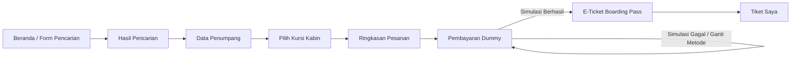

# ✈️ 1Tiket — Pemesanan Tiket Pesawat Domestik

> **"Boarding pass di bawah langit."**  
> Platform pemesanan tiket pesawat satu arah di Indonesia yang mengutamakan kualitas UI, tipografi berkarakter, dan animasi bertema penerbangan.

---

## 📋 Ringkasan Proyek
- **Nama Produk:** 1Tiket ("Satu Tiket")
- **Jenis Proyek:** Tugas / Pembelajaran Pemrograman Web
- **Fokus Utama:** Alur end-to-end pemesanan tiket pesawat satu arah dengan animasi bertema penerbangan (N1–N17) dan pembayaran dummy interaktif (QRIS, E-Wallet, Virtual Account).

---

## 🛠️ Tech Stack & Arsitektur
- **Backend:** Laravel 12 (REST API) + Laravel Sanctum untuk autentikasi token
- **Database:** MySQL 8 (9 tabel terelasi penuh: `users`, `airports`, `airlines`, `flights`, `flight_fares`, `bookings`, `booking_passengers`, `payment_methods`, `payments`)
- **Frontend:** React 19 + Vite + Tailwind CSS + React Router
- **Animasi:** Framer Motion + SVG dinamis + Tailwind Keyframes
- **Testing:** Playwright E2E testing

---

## 🚀 Panduan Menjalankan Aplikasi

### 1. Prasyarat
- PHP 8.2+
- Composer 2+
- Node.js 18+ & NPM
- MySQL Server berjalan di `127.0.0.1:3306`

### 2. Setup Lingkungan
1. Salin berkas lingkungan jika belum ada:
   ```bash
   cp .env.example .env
   ```
2. Pastikan konfigurasi database di `.env`:
   ```env
   DB_CONNECTION=mysql
   DB_HOST=127.0.0.1
   DB_PORT=3306
   DB_DATABASE=satu_tiket
   DB_USERNAME=root
   DB_PASSWORD=
   ```

### 3. Instalasi Dependensi & Migrasi Seeder
```bash
# 1. Install dependensi PHP
composer install

# 2. Migrasi dan isi data dummy (bandara, maskapai, 60 hari penerbangan, metode bayar, demo user)
php artisan migrate --seed

# 3. Install dependensi JavaScript
npm install

# 4. Build frontend untuk produksi
npm run build
```

### 4. Menjalankan Server
```bash
# Jalankan web server Laravel
php artisan serve
```
Buka browser pada: **`http://127.0.0.1:8000`**

*(Opsional untuk mode pengembangan dengan HMR: jalankan `npm run dev` pada terminal terpisah)*

---

## 👤 Akun Demo Penguji
Untuk memudahkan penguji/dosen mencoba alur tanpa registrasi manual:
- **Email:** `demo@1tiket.test`
- **Password:** `password`
- *(Tersedia tombol satu-klik **"Akun Demo"** di navbar dan halaman login)*

---

## 🧭 Alur Pemesanan (End-to-End)


1. **Pencarian Tiket (`/`):** Form autocomplete asal & tujuan, swap beranimasi, tanggal berangkat, penumpang (1–5), kelas kabin, dan peta rute mini interaktif Nusantara.
2. **Hasil Pencarian (`/cari`):** Strip tanggal ±3 hari dengan tarif termurah, filter waktu keberangkatan, pengurutan, penanda sisa kursi sedikit.
3. **Data Penumpang (`/pesan/penumpang`):** Wajib login (tersedia autofill dari profil pemesan) dan pengisian identitas penumpang per kursi.
4. **Denah Kabin (`/pesan/kursi`):** Denah interaktif (Bisnis 2-2, Ekonomi 3-3) dengan animasi pop kursi dan opsi lewati pemilihan kursi otomatis.
5. **Ringkasan (`/pesan/ringkasan`):** Rincian biaya transparan (biaya layanan Rp 5.000). Saat diproses, kursi ditahan selama 15 menit.
6. **Pembayaran Dummy (`/bayar/:kode`):** Timer cincin hitung mundur 15 menit, opsi QRIS dengan laser scan beam, Bank VA, E-Wallet, serta tombol simulasi bayar berhasil / gagal.
7. **E-Ticket Boarding Pass (`/tiket/:kode`):** Animasi boarding pass keluar dari celah printer, stub tiket dengan efek robekan interaktif, dan QR code tiket.
8. **Tiket Saya (`/tiket-saya`):** Tab riwayat pesanan (Menunggu Bayar, Terbayar, Kedaluwarsa, Dibatalkan).

---

## 🎨 Spesifikasi Animasi Penerbangan (N1–N17)
- **N1 Hero lepas landas:** Pesawat SVG melengkung dari landasan menuju langit kanan atas dengan jejak putus-putus.
- **N2 Awan di hero:** Lapisan awan bergeser pelan memberikan kedalaman visual.
- **N4 Peta rute mini:** Titik berdenyut di koordinat bandara asal & tujuan di peta Indonesia dengan busur penerbangan aktif.
- **N5 Tukar asal ↔ tujuan:** Ikon berputar 180° saat tombol tukar diklik.
- **N6 Loading hasil:** Pesawat meluncur di garis horizontal sebagai pengganti spinner biasa.
- **N7 Kartu penerbangan masuk:** Animasi kartu bertingkat (stagger) saat hasil pencarian dimuat.
- **N8 Garis durasi kartu:** Pesawat mini di garis durasi bergeser maju saat kartu di-hover.
- **N9 Denah kabin:** Kursi muncul dari depan ke belakang, kursi dipilih membesar (pop) dengan warna oranye.
- **N10 Stepper pemesanan:** Pesawat kecil meluncur antar langkah pemesanan.
- **N12 Hitung mundur bayar:** Cincin progres melingkar menyusut dan berubah warna menjadi merah saat waktu kritis (< 2 menit).
- **N13 Pindai QRIS:** Garis laser scan beam bergerak naik-turun di atas QR Code.
- **N14 Bayar berhasil:** Centang animasi dan pesawat lepas landas dari tengah layar menuju e-ticket.
- **N15 E-ticket keluar:** Boarding pass keluar secara bertahap dari celah printer dengan QR Code yang menyala.
- **N16 Stub tiket:** Stub tiket di sisi kanan memiliki efek robekan yang bergeser saat disentuh/hover.
- **N17 Mikro-interaksi:** Efek kompresi tombol 2% saat ditekan dan fokus field yang halus.

---

## 🧪 Pengujian Alur Playwright
Alur end-to-end telah diuji secara otomatis dan visual menggunakan Playwright MCP:
1. Navigasi Beranda → Form Pencarian CGK ✈ DPS
2. Pemilihan Tiket Penerbangan (Bayu Wings)
3. Autentikasi Pengguna Demo (`demo@1tiket.test`)
4. Pengisian Data Penumpang & Pemilihan Kursi Kabin (`7F`)
5. Penerbitan Kode Booking & Penahanan Kursi 15 Menit di MySQL
6. Simulasi Pembayaran QRIS Berhasil
7. Penerbitan Boarding Pass & Validasi di Halaman Tiket Saya
